<table>
<tr>
<td width="100%">한국 마이크로소프트<br>Microsoft Technical Trainer<br>Enterprise Skills Initiative</td>
</tr>
</table>

Copilot Studio

AI 기반 NOC 인시던트 관리 에이전트 구축

이 문서는 Microsoft Technical Trainer팀에서 ESI 교육 참석자분들에게 제공해 드리는 문서입니다.

<table>
<tr>
<td width="68%"></td>
<td width="32%"></td>
</tr>
</table>

요약

이 내용들은 표시된 날짜에 Microsoft에서 검토된 내용을 바탕으로 하고 있습니다. 따라서, 표기된 날짜 이후에 시장의 요구사항에 따라 달라질 수 있습니다. 이 문서는 고객에 대한 표기된 날짜 이후에 변화가 없다는 것을 보증하지 않습니다.

이 문서는 정보 제공을 목적으로 하며 어떠한 보증을 하지는 않습니다.

저작권에 관련된 법률을 준수하는 것은 고객의 역할이며, 이 문서를 마이크로소프트의 사전 동의 없이 어떤 형태(전자 문서, 물리적인 형태 막론하고) 어떠한 목적으로 재 생산, 저장 및 다시 전달하는 것은 허용되지 않습니다.

마이크로소프트는 이 문서에 들어있는 특허권, 상표, 저작권, 지적 재산권을 가집니다. 문서를 통해 명시적으로 허가된 경우가 아니면, 어떠한 경우에도 특허권, 상표, 저작권 및 지적 재산권은 다른 사용자에게 허여되지 아니합니다.

© 2026 Microsoft Corporation All right reserved.

Microsoft®는 미합중국 및 여러 나라에 등록된 상표입니다.

이 문서에 기재된 실제 회사 이름 및 제품 이름은 각 소유자의 상표일 수 있습니다.

문서 작성 연혁

<table>
<tr>
<td width="15%">날짜</td>
<td width="11%">버전</td>
<td width="13%">작성자</td>
<td width="62%">변경 내용</td>
</tr>
<tr>
<td>2026.11.06</td>
<td>0.9.0</td>
<td>우진환</td>
<td>문서 초안 작성</td>
</tr>
<tr>
<td>2026.11.12</td>
<td>1.0.0</td>
<td>우진환</td>
<td>문서 서식 적용</td>
</tr>
</table>

목차

- [개요](#개요)
- [TASK 01. Power Platform 환경 만들기](#task-01-power-platform-환경-만들기)
- [TASK 02. Copilot Studio의 GitHub Copilot 하네스 시작하기](#task-02-copilot-studio의-github-copilot-하네스-시작하기)
- [TASK 03. 솔루션 만들기](#task-03-솔루션-만들기)

## 개요

이 실습에서는 실습에 필요한 Power Platform 환경을 만듭니다.

# TASK 01. Power Platform 환경 만들기

1. 브라우저를 열고

   ```text
   https://admin.powerplatform.com
   ```

   사이트에 실습 환경에서 제공하는 계정과 암호를 사용하여 액세스합니다.

2. 기본 환경에 Dataverse를 추가해야 합니다. \[관리 | 환경\]으로 이동한 후 "`Contoso(기본)`" 환경을 선택하고 \[… − Dataverse 추가\]를 클릭합니다.

   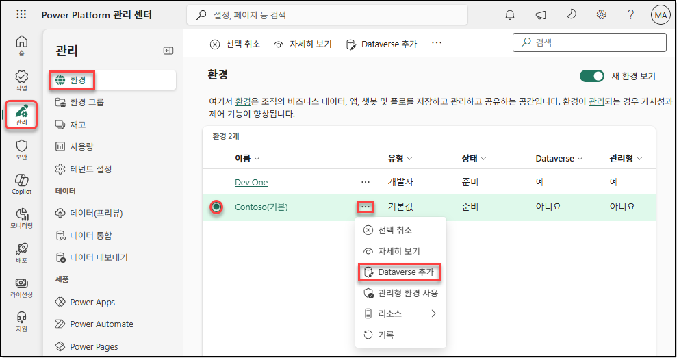

3. \[Dataverse 추가\] 창에서 다음과 같이 구성한 후 \[추가\]를 클릭합니다.
   - 언어: 한국어(대한민국)
   - 통화: KRW (₩)
   - 샘플 앱 및 데이터를 배포하시겠어요: 아니요

   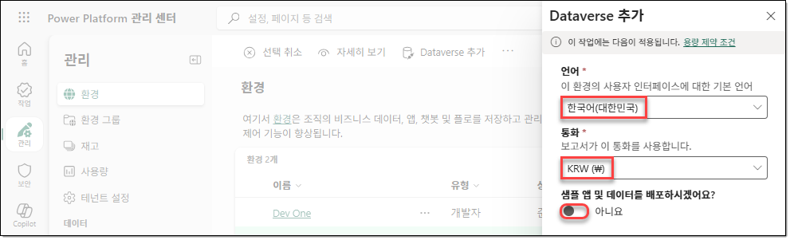

4. 실습에서 사용할 새 환경을 만들기 위해 \[관리 | 환경\]의 메뉴에서 \[+ 새로 만들기\]를 클릭합니다.

   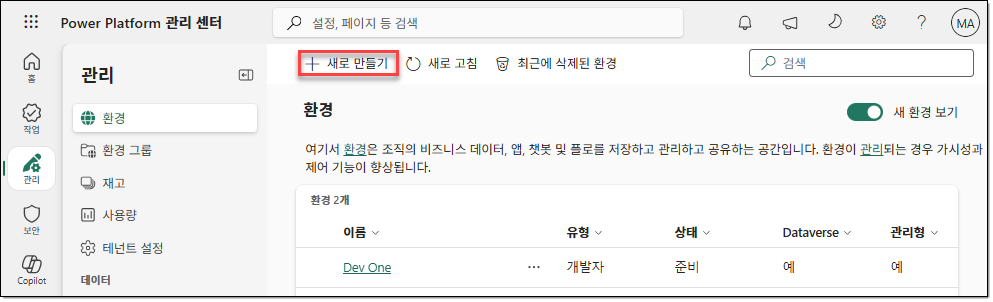

5. \[새 환경\] 창에서 아래와 같이 구성한 후 \[다음\]을 클릭합니다.
   - 유형: 개발자
   - 매크로 지역 지리: 아시아 태평양
   - 이름:

     ```text
     GHCopilotEnv
     ```

   - \[기본 설정 변경 − 환경 그룹\]: 없음
   - \[기본 설정 변경 − 관리형 환경으로 설정\]: 아니요
   - \[기본 설정 변경 − 대신 만들기\]: 아니요
   - \[기본 설정 변경 − Dataverse 데이터 저장소를 추가하시겠습니까\]: 예
   - \[기본 설정 변경 − Azure 종량제를 이용하시겠습니까\]: 아니요

   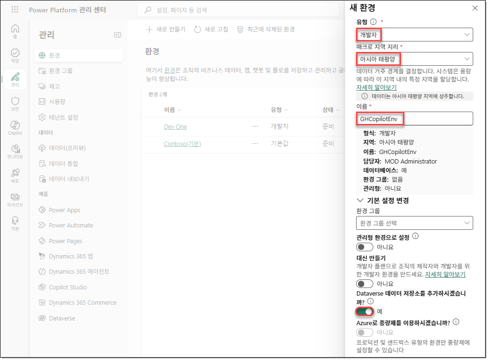

6. \[Dataverse 추가\] 창에서 아래와 같이 구성한 후 \[저장\]을 클릭합니다.
   - 언어: 한국어(대한민국)
   - 통화: KRW (₩)
   - 샘플 앱 및 데이터를 배포하시겠어요: 아니요

   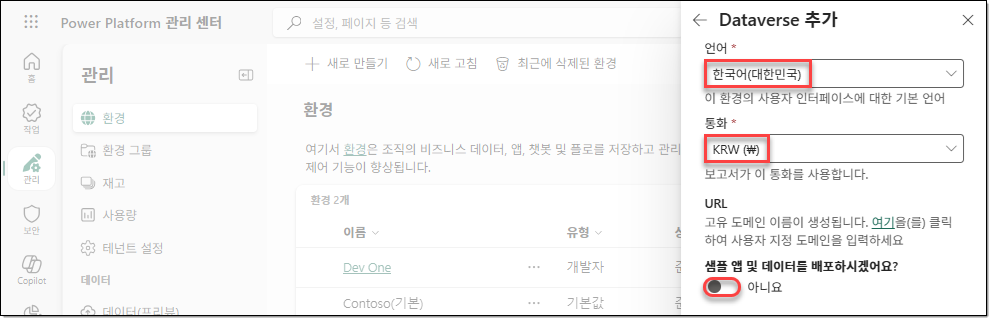

7. \[관리 | 환경\] 페이지의 메뉴에서 \[새로 고침\]을 클릭하여 새로 만든 환경이 "`준비`" 상태로 표시될 때까지 기다립니다. 환경이 "`준비`" 상태로 표시될 때까지 몇 분이 걸릴 수 있습니다.

   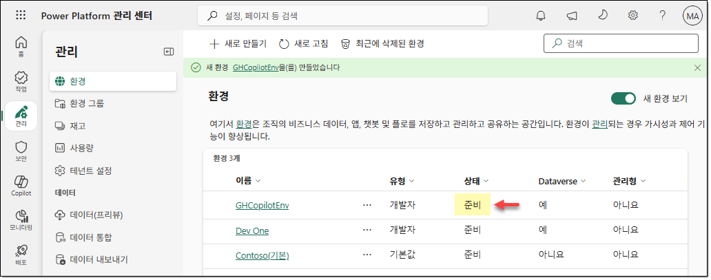

# TASK 02. Copilot Studio의 GitHub Copilot 하네스 시작하기

1. 브라우저에서 새 탭을 열고

   ```text
   https://copilotstudio.preview.microsoft.com
   ```

   사이트로 이동합니다. Copilot Studio에 로그인되지 않는 경우 `GHCopilotEnv` 환경의 환경 ID를 복사하여 다음 URL을 구성한 후 액세스합니다.

   <table>
   <tr>
   <td width="100%">

   ```text
   https://copilotstudio.preview.microsoft.com/environments/<your-environment-id>/home
   ```

   </td>
   </tr>
   </table>

2. 새로운 Copilot Studio 환경이 표시되면 왼쪽 아래의 환경 선택기를 클릭한 후 "`GHCopilotEnv`" 환경을 선택합니다.

   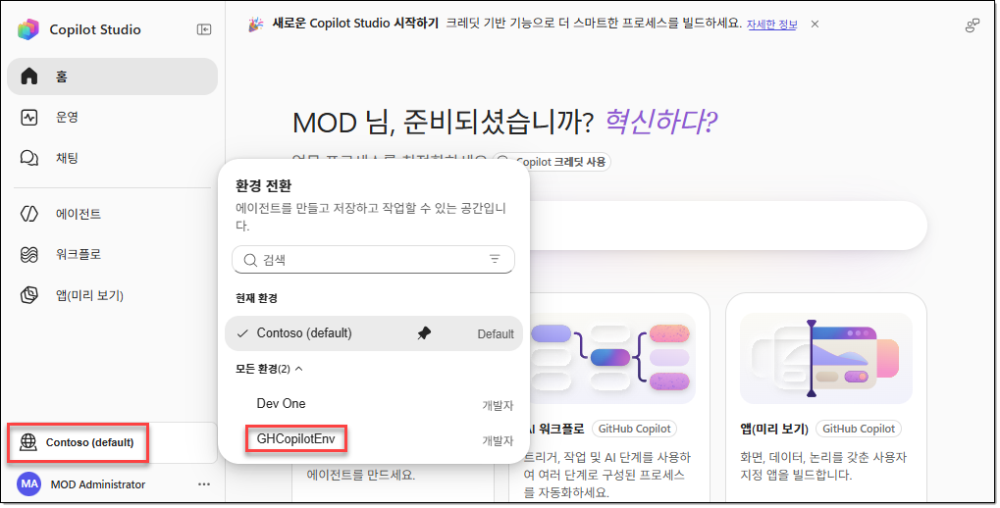

# TASK 03. 솔루션 만들기

1. 왼쪽 내비게이션 메뉴에서 로그인 계정 우측의 \[…\]을 클릭한 후 \[탐색하기 | 솔루션\]을 선택합니다.

   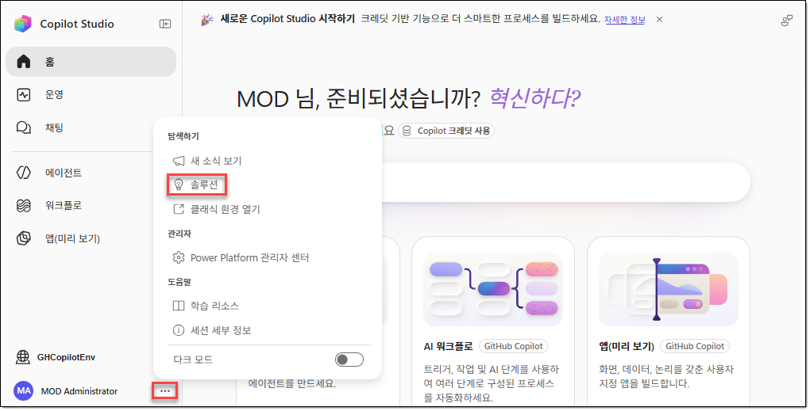

2. Copilot Studio의 새 환경에서 \[솔루션\]을 선택하면 클래식 환경으로 이동됩니다. Copilot Studio의 클래식 포털에서 새로운 솔루션을 만들어야 합니다. 왼쪽 내비게이션 메뉴에서 \[… − 솔루션\]을 클릭합니다.

   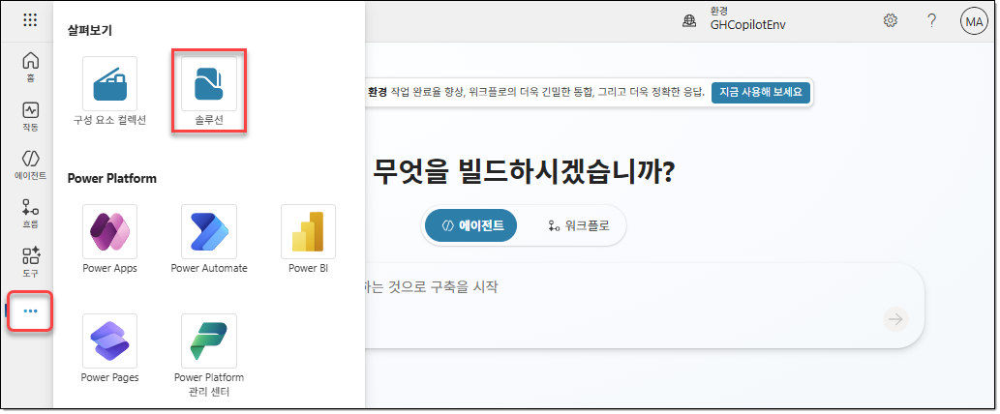

3. \[솔루션\] 페이지의 메뉴에서 \[+ 새 솔루션\]을 클릭합니다.

   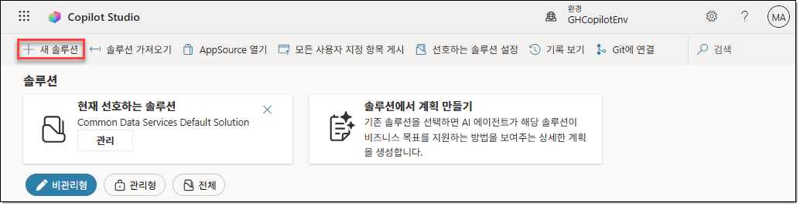

4. \[새 솔루션\] 창에서 아래와 같이 구성합니다.
   - 표시 이름:

     ```text
     LabSolution
     ```

   - 이름:

     ```text
     LabSolution
     ```

   - 게시자: \[+ 새 게시자\]를 클릭합니다.

   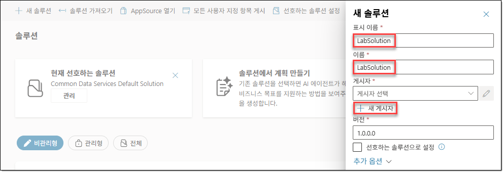

5. \[새 게시자\] 창의 \[속성\] 탭에서 아래와 같이 구성하고 \[저장\]을 클릭합니다.
   - 표시 이름:

     ```text
     Fabrikam
     ```

   - 이름:

     ```text
     fabrikam
     ```

   - 접두사:

     ```text
     fab
     ```

   - 선택 값 접두사: 기본값을 사용합니다.

   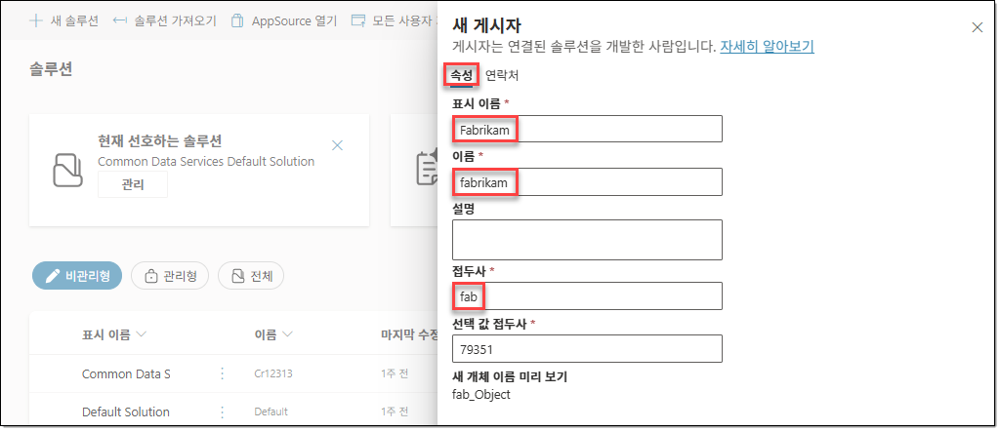

6. \[새 솔루션\] 창이 다시 표시되면 게시자에 앞서 만들었던 "`Fabrikam (fabrikam)`" 게시자를 선택하고 "`선호하는 솔루션으로 설정`" 옵션을 선택한 후 \[만들기\]를 클릭합니다. 이 솔루션을 선호하는 솔루션(기본 솔루션)으로 설정하면 이후 실습에서 새로 만드는 모든 구성 요소가 기본적으로 이 솔루션에 추가됩니다.

   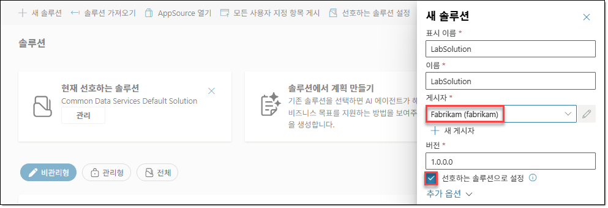
